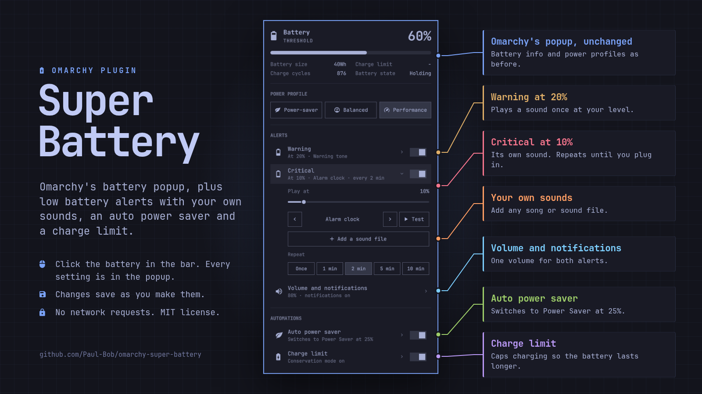
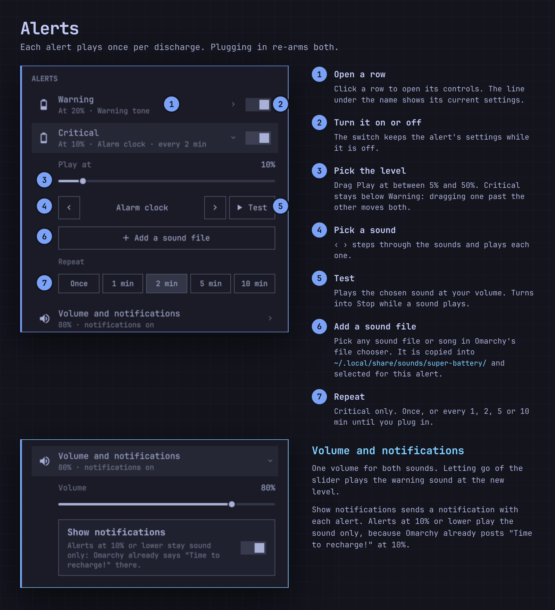
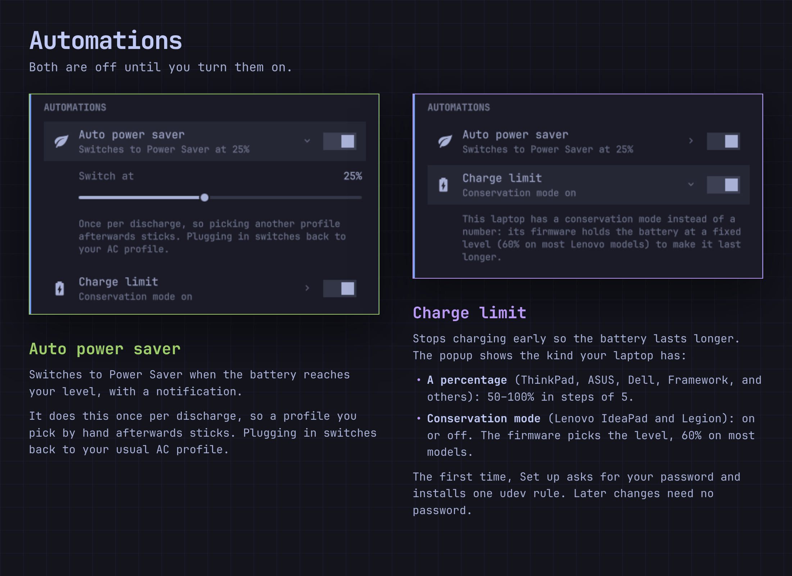
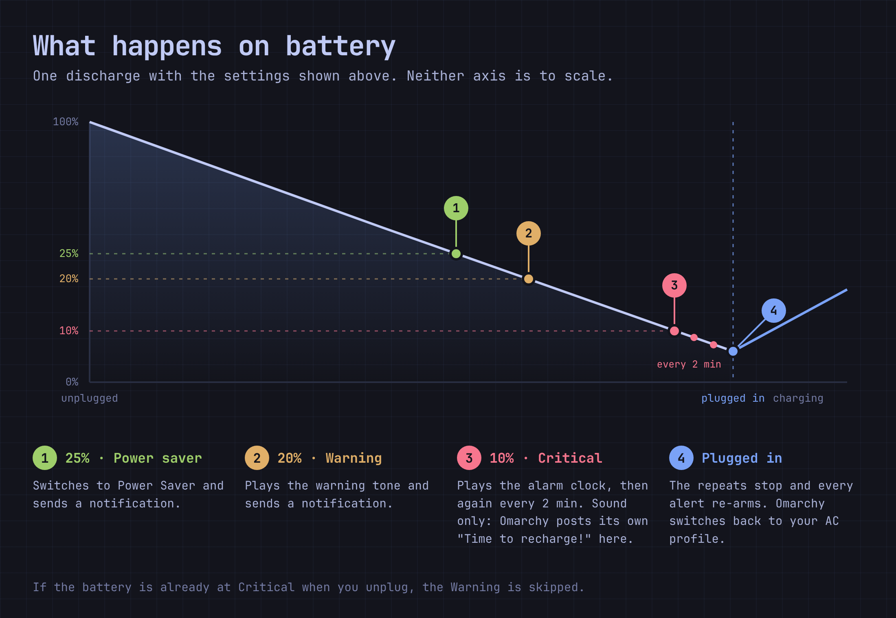

# Super Battery for Omarchy

Omarchy's battery popup, plus low battery alerts that play built-in sounds
or your own files (songs too), an automatic power saver, and a charge limit.
Every setting is in the popup itself: click the battery in the bar.



Every row shows its current setting in one line. Click a row to open its
controls; the switch on the right turns it on or off. Changes save as you
make them.

The rest of the popup (battery info, power profile buttons, right-click on
the icon to show the percentage) is Omarchy's own and works as before.

## Install

```bash
omarchy plugin add https://github.com/Paul-Bob/omarchy-super-battery --enable
omarchy bar move paulbob.super-battery --after omarchy.power
omarchy plugin disable omarchy.power
```

The last two lines put it where the Power widget was and take the Power
widget off the bar, so you do not see two battery icons.

To remove it, bring the Power widget back and turn Super Battery off:

```bash
omarchy plugin enable omarchy.power --after paulbob.super-battery
omarchy plugin disable paulbob.super-battery
```

If you ran the charge limit setup, also delete
`/etc/udev/rules.d/90-super-battery-charge-limit.rules` and reboot.

## Alerts



- **Warning**: plays a sound once at a level you pick (default 20%).
- **Critical**: its own level (default 10%) and its own sound. It can repeat
  every 1, 2, 5 or 10 minutes until you plug in.
- **Volume and notifications**: one volume for both sounds, and whether a
  notification comes with them.

Levels go from 5% to 50%, and Critical always stays below Warning: dragging
one level past the other moves both. The ‹ › arrows step through the sounds
and play each one; **Test** plays the chosen sound at your volume.
**Add a sound file** lets you pick your own (see
[Your own sounds](#your-own-sounds)).

## Automations



- **Auto power saver**: switches to Power Saver at a level you pick. It does
  this once per discharge, so a profile you pick by hand afterwards sticks.
  Plugging in switches back to your usual AC profile.
- **Charge limit**: stops charging early so the battery lasts longer (see
  [Charge limit](#charge-limit)).

Both are off until you turn them on.

## What happens on battery



Alerts only fire on battery, once per discharge each. Plugging in re-arms
them. If the battery is already at Critical when you unplug, the Warning is
skipped.

## Your own sounds

Open Warning or Critical and click **Add a sound file**. Omarchy's file
chooser opens. The file you pick is copied into
`~/.local/share/sounds/super-battery/`, selected for that alert, and played.
The copy keeps working if you move or delete the original.

Songs work too. **Test** turns into **Stop** while a sound plays, and
plugging in stops an alert sound that is still playing.

The chooser accepts `.oga`, `.ogg`, `.wav`, `.flac`, `.mp3` and `.opus`. You
can also put such files (or symlinks to them) in that folder yourself; the
‹ › arrows include them the next time you open the popup.

## Charge limit

Laptops offer one of two kinds, and the popup shows whichever yours has:

- **A percentage** (ThinkPad, ASUS, Dell, Framework, and others): pick 50–100%
  in steps of 5.
- **Conservation mode** (Lenovo IdeaPad and Legion): on or off. The firmware
  picks the level, 60% on most models.

Changing it needs root once. The first time, the popup shows **Set up**, which
asks for your password and installs one udev rule,
`/etc/udev/rules.d/90-super-battery-charge-limit.rules`. The rule gives your
user's group write access to the charge limit files, so later changes need no
password. To undo it, delete that file and reboot.

When the limit is on, Super Battery writes it again each time the shell
starts, for laptops whose firmware forgets it on reboot. It never switches a
limit off unless you flip the switch.

## Requirements

Omarchy 4 (tested on 4.0.6). Everything else ships with Omarchy:

| Package | Used for |
|---|---|
| `pipewire-audio` | `pw-play` plays the sounds |
| `sound-theme-freedesktop` | the built-in sounds |
| `power-profiles-daemon` | `powerprofilesctl` switches to Power Saver |
| `xdg-desktop-portal-gtk` | the file chooser behind `omarchy-file-select` |
| `polkit` | `pkexec` for the one-time charge limit setup |
| `systemd` | `udevadm` loads the charge limit rule |

## How it fits with Omarchy

Omarchy's `omarchy.battery` service keeps running. It still posts its own
"Time to recharge!" notification at 10% and still switches power profiles
when you plug in or unplug. To avoid two notifications at once, Super Battery
plays its sound but sends no notification for alerts at 10% or lower.

Settings are saved on the widget's own entry in `~/.config/omarchy/shell.json`.
The plugin makes no network requests.

The popup is a copy of Omarchy's Power widget (`shell/plugins/panels/power`,
Omarchy 4.0.6) with the Alerts and Automations sections added. Omarchy's
updates to that widget do not reach this copy on their own. See
[NOTICE.md](NOTICE.md).

## Tests

```bash
node test/test_model.js         # alert rules, power saver, charge limit, settings
test/test_charge_limit.sh       # bin/charge-limit against fake sysfs trees
test/test_add_sound.sh          # bin/add-sound with a stand-in file chooser
test/run-harness.sh             # the service against real UPower and pw-play; plays a few short sounds quietly
```

## License

MIT. Parts copied from Omarchy are MIT too; see [NOTICE.md](NOTICE.md).
